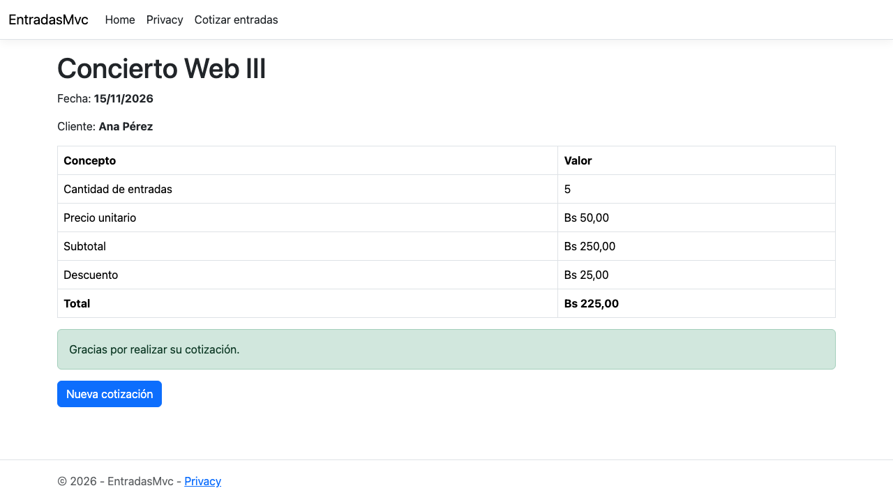
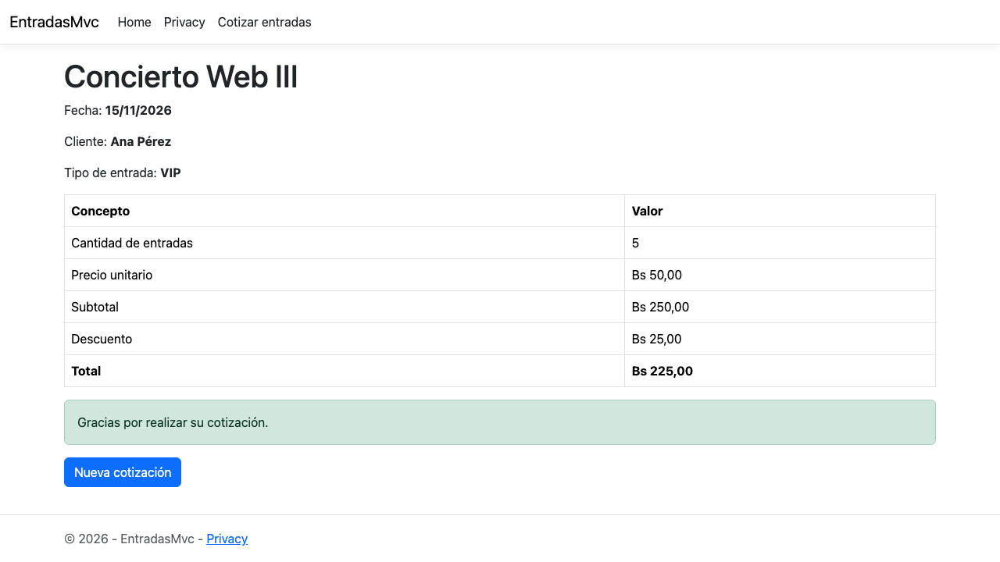

# EntradasMvc

Práctica guiada **"ViewModels en ASP.NET Core MVC"** · Web III · ASP.NET Core MVC · .NET 10.

Continuación del cotizador de entradas de la práctica 1. La aplicación ahora separa tres responsabilidades:

- **Entrada:** `CotizacionInputViewModel` recibe y valida los datos del formulario.
- **Negocio:** `Cotizacion` aplica las reglas de cálculo.
- **Presentación:** `ResultadoCotizacionViewModel` reúne lo que necesita la pantalla de resultado.

Cada entrada cuesta **Bs 50** y desde **5 entradas** se aplica un **10 % de descuento**. La aplicación no usa base de datos ni migraciones.

> La práctica 1 está documentada en [`docs/practica-1-mvc.md`](docs/practica-1-mvc.md). Su código quedó guardado en el tag [`practica-1-mvc`](https://github.com/andredellien/EntradasMvc/tree/practica-1-mvc).

## Cómo ejecutar

```bash
dotnet run --project EntradasMvc --launch-profile http
```

Abrir `http://localhost:5143/Entradas` o pulsar **Cotizar entradas** en el menú.

## Estructura final

```text
EntradasMvc
├── Controllers
│   └── EntradasController.cs
├── Models
│   └── Cotizacion.cs
├── ViewModels
│   ├── CotizacionInputViewModel.cs
│   └── ResultadoCotizacionViewModel.cs
├── Views
│   └── Entradas
│       ├── Index.cshtml
│       └── Resultado.cshtml
└── Program.cs
```

| Archivo | Rol | Contenido |
|---|---|---|
| [`Models/Cotizacion.cs`](EntradasMvc/Models/Cotizacion.cs) | Model | Cliente, cantidad, tipo de entrada y las reglas de precio, subtotal, descuento y total |
| [`ViewModels/CotizacionInputViewModel.cs`](EntradasMvc/ViewModels/CotizacionInputViewModel.cs) | ViewModel de entrada | Solo los campos del formulario, con sus Data Annotations |
| [`ViewModels/ResultadoCotizacionViewModel.cs`](EntradasMvc/ViewModels/ResultadoCotizacionViewModel.cs) | ViewModel de salida | La cotización más evento, fecha y mensaje |
| [`Controllers/EntradasController.cs`](EntradasMvc/Controllers/EntradasController.cs) | Controller | `Index` crea el ViewModel de entrada; `Calcular` lo valida, lo convierte en `Cotizacion` y arma el ViewModel de resultado |
| [`Views/Entradas/Index.cshtml`](EntradasMvc/Views/Entradas/Index.cshtml) | View | Formulario tipado a `CotizacionInputViewModel` |
| [`Views/Entradas/Resultado.cshtml`](EntradasMvc/Views/Entradas/Resultado.cshtml) | View | Resultado tipado a `ResultadoCotizacionViewModel` |

## Flujo

```text
Index.cshtml
   │ POST
   ▼
CotizacionInputViewModel      1. ENTRADA
   │ Model Binding
   ▼
EntradasController
   │
   ▼
Cotizacion                    2. NEGOCIO
   │ reglas de negocio
   ▼
ResultadoCotizacionViewModel  3. PRESENTACIÓN
   │
   ▼
Resultado.cshtml
```

## Verificaciones

### Pasos 6 y 13. Las vistas solo ven su ViewModel

La comprobación con IntelliSense se reforzó con el compilador. Se agregó temporalmente `@Model.Subtotal` en `Index.cshtml` y el proyecto no compiló:

```text
error CS1061: "CotizacionInputViewModel" no contiene una definición para "Subtotal"
```

`Index.cshtml` ya no conoce `Subtotal`, `Descuento` ni `Total`, porque trabaja con `CotizacionInputViewModel` y no con `Cotizacion`. La línea temporal se eliminó.

### Paso 8. Recibir el ViewModel desde el formulario

Con la versión temporal de `Calcular`, que devuelve `Content(...)`, al enviar Ana Pérez y 5 se obtuvo `Cliente: Ana Pérez - Cantidad: 5`. Model Binding creó `CotizacionInputViewModel` con esos dos valores.


### Paso 9. Validaciones del ViewModel

| Cliente | Cantidad | Resultado esperado | Resultado obtenido | Captura |
|---|---|---|---|---|
| vacío | 2 | Error de campo obligatorio | "Ingrese el nombre del cliente." | [ver](docs/capturas-viewmodels/09-validacion-1-vacio.png) |
| AB | 2 | Error de longitud mínima | "El nombre debe tener entre 3 y 60 caracteres." | [ver](docs/capturas-viewmodels/09-validacion-2-ab.png) |
| Ana Pérez | 0 | Error de rango | "La cantidad debe estar entre 1 y 10." | [ver](docs/capturas-viewmodels/09-validacion-3-cero.png) |
| Ana Pérez | 5 | Datos válidos | `Cliente: Ana Pérez - Cantidad: 5` | [ver](docs/capturas-viewmodels/09-validacion-4-valido.png) |
| Ana Pérez | 11 | Error de rango | "La cantidad debe estar entre 1 y 10." | [ver](docs/capturas-viewmodels/09-validacion-5-once.png) |

Las mismas reglas también se probaron enviando el POST directamente al servidor, sin la validación del navegador, y `ModelState.IsValid` las rechazó.

### Paso 15. Resultado con el ViewModel de salida

Ana Pérez con 5 entradas muestra Concierto Web III, fecha 15/11/2026, subtotal Bs 250, descuento Bs 25, total Bs 225 y el mensaje de agradecimiento.



### Paso 17. La vista Resultado está fuertemente tipada

Con `@Model.Nombre` temporal en `Resultado.cshtml`, el proyecto no compiló:

```text
error CS1061: "ResultadoCotizacionViewModel" no contiene una definición para "Nombre"
```

Con `@Model.Cotizacion.Cliente` el proyecto compiló sin errores. Las dos líneas temporales se eliminaron.

## Ejercicio individual: tipo de entrada

El formulario permite elegir **General** o **VIP** con un `<select asp-for="TipoEntrada">`. El valor llega a `Calcular` por Model Binding y el resultado muestra `Tipo de entrada: VIP`.

Decisiones tomadas:

- **Validación.** `TipoEntrada` usa `[Required]` y `[Display(Name = "Tipo de entrada")]`, como pide la consigna, con el mensaje de error en español. Además tiene `[RegularExpression("^(General|VIP)$")]`. Así el servidor rechaza un valor que no está en la lista aunque alguien modifique el POST. Ese atributo ignora el valor vacío, por eso el caso vacío lo resuelve solo `[Required]` y el mensaje no se duplica.
- **Ubicación.** El tipo se guarda en `Cotizacion`, junto a `Cliente` y `Cantidad`, porque es un dato que el cliente elige y describe qué se está cotizando. `Evento`, en cambio, lo agrega el controlador solo para presentar la pantalla, por eso vive en `ResultadoCotizacionViewModel`. El tipo no cambia el precio, porque la consigna no lo pide.

| Prueba | Datos | Resultado | Captura |
|---|---|---|---|
| Formulario | Selector con "Seleccione un tipo", General y VIP | Se muestra el selector | [ver](docs/capturas-viewmodels/21-formulario-tipo.png) |
| Sin tipo | Ana Pérez, 5, sin seleccionar | "Seleccione el tipo de entrada." | [ver](docs/capturas-viewmodels/21-sin-tipo.png) |
| VIP | Ana Pérez, 5, VIP | `Tipo de entrada: VIP`, total Bs 225 | [ver](docs/capturas-viewmodels/21-resultado-vip.png) |
| POST manipulado | Ana Pérez, 5, `Platinum` | "Seleccione un tipo de entrada válido." | Probado directamente contra el servidor |



## Model vs ViewModel

| Característica | Model | ViewModel |
|---|---|---|
| Representa datos y comportamiento del dominio | Sí | No necesariamente |
| Puede contener reglas de negocio | Sí | No debería ser su responsabilidad principal |
| Está diseñado específicamente para una vista | No necesariamente | Sí |
| Puede contener datos de varias fuentes | Puede | Sí |
| Puede recibir datos de un formulario | Sí | Sí |
| Puede enviarse a una vista | Sí | Sí |
| Debe representar una tabla de BD | No necesariamente | No |
| Puede utilizar Data Annotations | Sí | Sí |
| Puede limitar exactamente qué datos acepta una pantalla | No es su finalidad principal | Sí |

## Respuestas

**1. ¿Cuál es la diferencia principal entre Model y ViewModel?**

El Model representa el dominio: sus datos y sus reglas de negocio. `Cotizacion` sabe calcular subtotal, descuento y total. El ViewModel se diseña para una pantalla concreta y contiene solo lo que esa vista necesita enviar o mostrar. `CotizacionInputViewModel` tiene únicamente los campos del formulario, y `ResultadoCotizacionViewModel` junta la cotización con el evento, la fecha y el mensaje. El Model responde qué es una cotización; el ViewModel responde qué necesita esta pantalla.

**2. ¿Cómo sabe una vista qué tipo de ViewModel recibe?**

Por la directiva `@model` al inicio del archivo, por ejemplo `@model EntradasMvc.ViewModels.ResultadoCotizacionViewModel`. Esa directiva vuelve la vista fuertemente tipada: `Model` tiene ese tipo, IntelliSense ofrece sus propiedades y el compilador rechaza las que no existen. Se comprobó con `@Model.Nombre`, que produjo el error CS1061. El controlador debe pasar un objeto de ese tipo en `View(...)`.

**3. ¿Qué función cumple Model Binding?**

Convierte los datos de la solicitud HTTP en el objeto que recibe la acción. Toma los campos del formulario, busca en el parámetro una propiedad con el mismo nombre, convierte el tipo y asigna el valor; por ejemplo, el texto `"5"` pasa a ser el entero `5`. Después se ejecutan las Data Annotations y el resultado queda en `ModelState`. En `Calcular`, Model Binding crea `CotizacionInputViewModel` a partir de `Cliente`, `Cantidad` y `TipoEntrada`.

**4. ¿Puede un ViewModel recibir datos desde el navegador? Explique.**

Sí. Un ViewModel sirve en los dos sentidos. `CotizacionInputViewModel` es el parámetro de `Calcular`: los Tag Helpers `asp-for` generan campos cuyo `name` coincide con sus propiedades, el navegador los envía por POST y Model Binding crea el objeto. `ResultadoCotizacionViewModel` muestra el sentido contrario: va del controlador hacia la vista.

**5. ¿Qué son las Data Annotations?**

Son atributos de `System.ComponentModel.DataAnnotations` que se colocan sobre las propiedades para describirlas y validarlas, como `[Required]`, `[StringLength]`, `[Range]`, `[RegularExpression]` y `[Display]`. MVC las evalúa en el servidor y registra los errores en `ModelState`. Los Tag Helpers las traducen a atributos `data-val-*` para que el navegador valide antes de enviar. `[Display]` define el texto que muestra la etiqueta generada con `asp-for`.

**6. ¿Por qué `Evento` puede pertenecer al ViewModel de resultado y no necesariamente a `Cotizacion`?**

Porque no participa en ninguna regla de cálculo: el subtotal, el descuento y el total son los mismos sea cual sea el evento. Es información que solo necesita la pantalla de resultado para presentarse, y la agrega el controlador, no el usuario. Si estuviera en `Cotizacion`, el modelo de dominio cargaría datos de presentación que no le corresponden.

**7. ¿Dónde debe permanecer la regla del descuento y por qué?**

En el Model `Cotizacion`, en la propiedad `Descuento`. Es una regla de negocio, no una necesidad de presentación, y debe dar el mismo resultado sin importar qué vista la muestre. Si estuviera en un ViewModel o en una vista, habría que repetirla en cada pantalla, las copias podrían diferir y no se podría probar sin la capa web.

**8. ¿Un ViewModel representa obligatoriamente una tabla de la base de datos?**

No. Un ViewModel se diseña según lo que necesita una pantalla, no según el esquema de datos. En esta práctica no hay base de datos: `ResultadoCotizacionViewModel` combina un objeto `Cotizacion` con datos fijos de evento, fecha y mensaje. No está en un `DbContext` ni necesita migraciones.

**9. Explique el recorrido completo desde que se pulsa Calcular hasta que aparece el resultado.**

1. El navegador valida el formulario con los atributos `data-val-*` y, si pasa, envía un POST a `/Entradas/Calcular` con `Cliente`, `Cantidad`, `TipoEntrada` y el token antifalsificación.
2. El enrutamiento elige `EntradasController.Calcular` y `[ValidateAntiForgeryToken]` verifica el token.
3. Model Binding crea `CotizacionInputViewModel` y se evalúan sus Data Annotations.
4. Si `ModelState.IsValid` es `false`, el controlador devuelve `View("Index", viewModel)` con los datos y los errores.
5. Si es válido, el controlador crea `Cotizacion` con los datos del ViewModel de entrada.
6. `Cotizacion` calcula los importes: con 5 entradas, subtotal Bs 250, descuento Bs 25 y total Bs 225.
7. El controlador crea `ResultadoCotizacionViewModel` con la cotización, el evento, la fecha y el mensaje.
8. `View("Resultado", resultadoViewModel)` renderiza `Resultado.cshtml` y el HTML vuelve al navegador en la misma respuesta, sin redirección.

**10. ¿Qué ventaja tiene utilizar un ViewModel de entrada en un formulario?**

Define exactamente qué datos acepta esa pantalla: solo `Cliente`, `Cantidad` y `TipoEntrada`. Si alguien envía campos de más, no hay propiedad donde enlazarlos, lo que evita el overposting. Las validaciones del formulario quedan en una clase propia, separadas de las reglas del dominio. Además, si el formulario cambia, el Model no se toca.

## Entregables

- Enlace del repositorio: https://github.com/andredellien/EntradasMvc
- Respuestas a las 10 preguntas: sección anterior.
