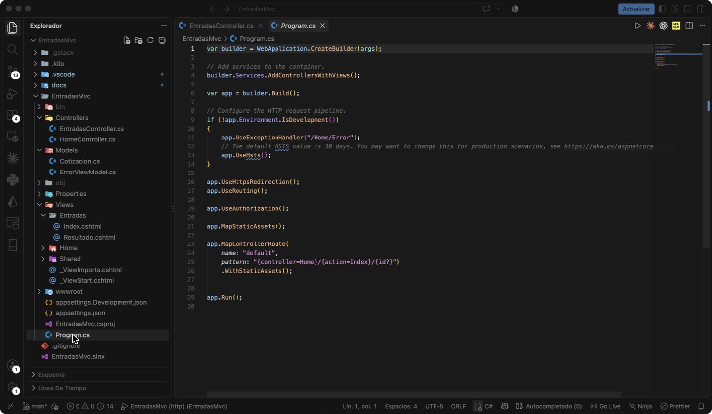
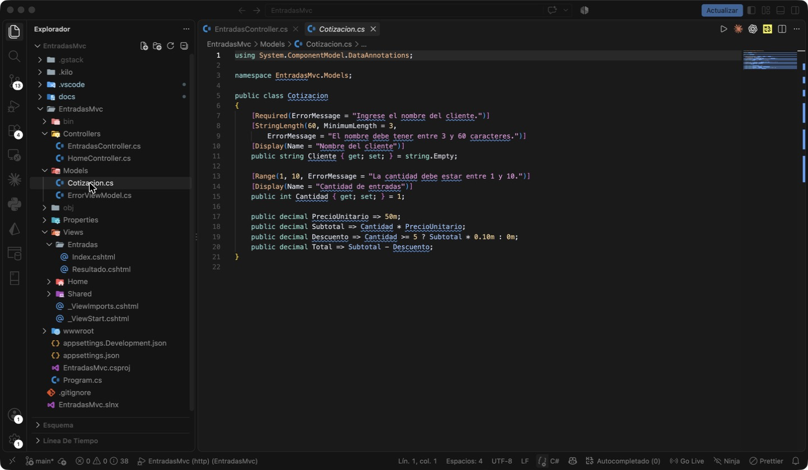
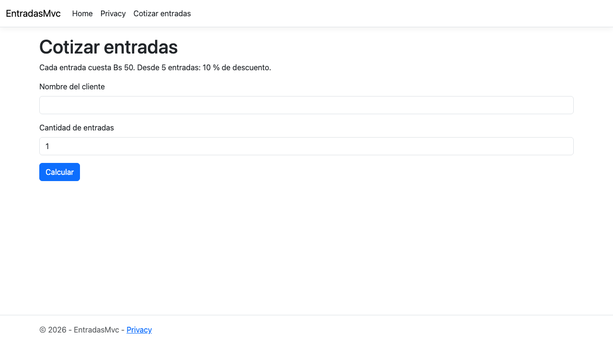
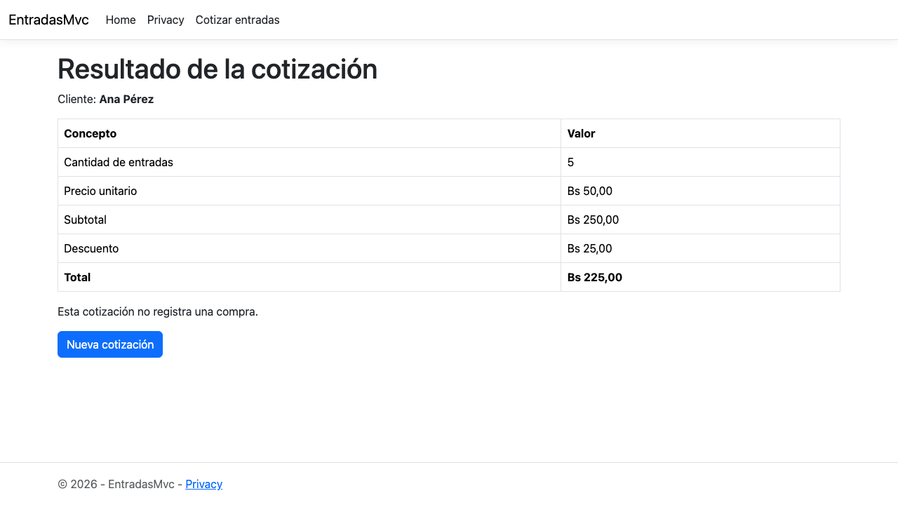
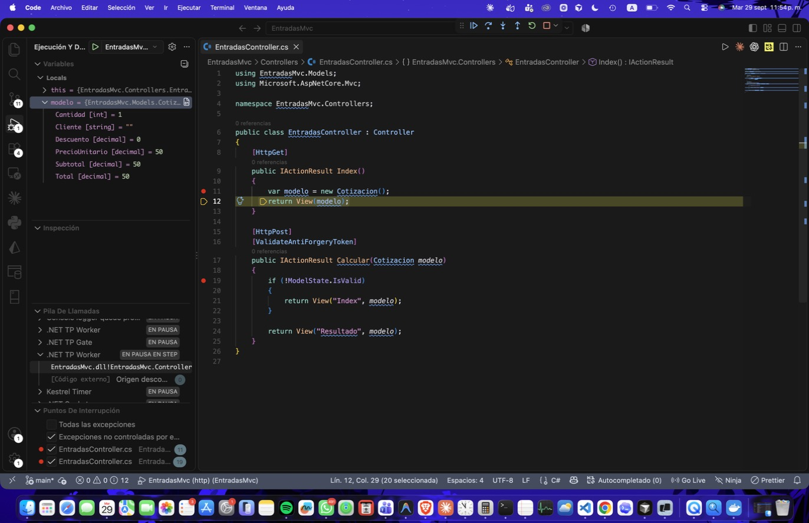
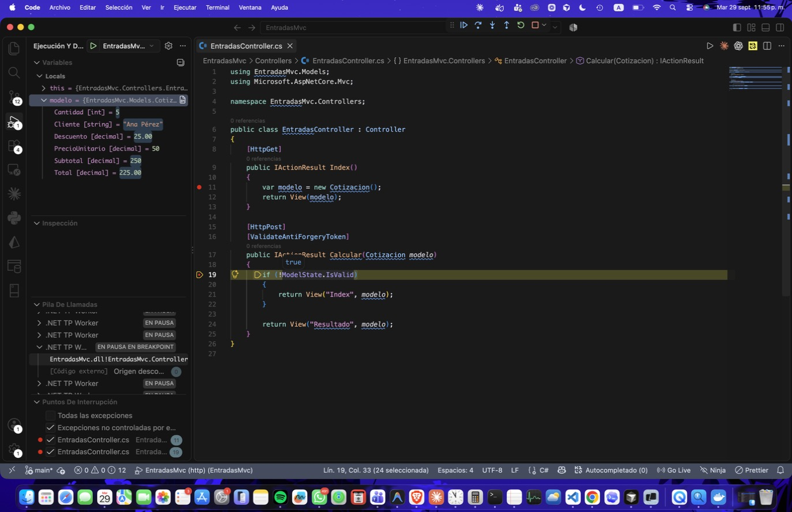
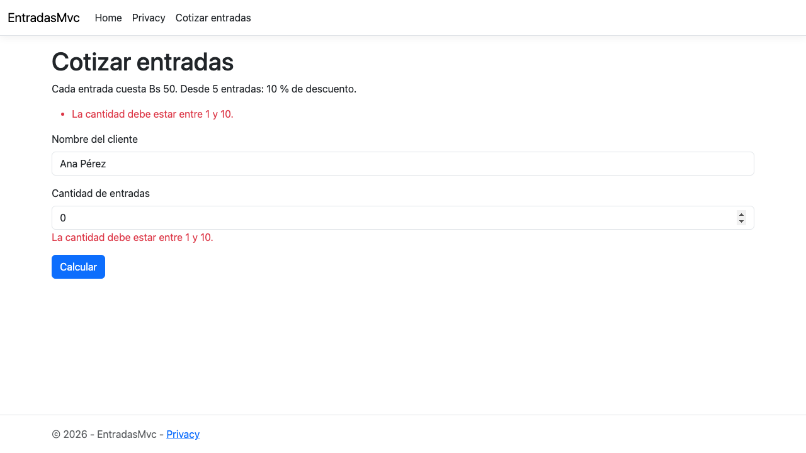

# Práctica 1: mi primera aplicación MVC

Práctica guiada **"Mi primera aplicación MVC"** · Web III · ASP.NET Core MVC · .NET 10.

> Este documento describe el proyecto tal como quedó al terminar la práctica 1, guardado en el tag [`practica-1-mvc`](https://github.com/andredellien/EntradasMvc/tree/practica-1-mvc). La rama `main` continúa con la práctica de ViewModels.

Cotizador de entradas para un evento. Un formulario recibe el nombre del cliente y la cantidad de entradas; el servidor valida los datos y muestra el desglose del precio. Cada entrada cuesta **Bs 50** y desde **5 entradas** se aplica un **10 % de descuento**. La aplicación calcula una cotización: no registra compras ni guarda información.

## Cómo ejecutar

```bash
dotnet run --project EntradasMvc --launch-profile http
```

Abrir `http://localhost:5143/Entradas` o pulsar **Cotizar entradas** en el menú.

## Dónde está cada parte de MVC

| Parte | Archivo | Responsabilidad |
|---|---|---|
| Modelo | [`EntradasMvc/Models/Cotizacion.cs`](https://github.com/andredellien/EntradasMvc/blob/practica-1-mvc/EntradasMvc/Models/Cotizacion.cs) | Datos de entrada, validaciones y regla del descuento |
| Controlador | [`EntradasMvc/Controllers/EntradasController.cs`](https://github.com/andredellien/EntradasMvc/blob/practica-1-mvc/EntradasMvc/Controllers/EntradasController.cs) | `Index` (GET) muestra el formulario; `Calcular` (POST) recibe, valida y elige la vista |
| Vista | [`EntradasMvc/Views/Entradas/Index.cshtml`](https://github.com/andredellien/EntradasMvc/blob/practica-1-mvc/EntradasMvc/Views/Entradas/Index.cshtml) | Formulario con validación |
| Vista | [`EntradasMvc/Views/Entradas/Resultado.cshtml`](https://github.com/andredellien/EntradasMvc/blob/practica-1-mvc/EntradasMvc/Views/Entradas/Resultado.cshtml) | Tabla con el desglose calculado por el modelo |
| Layout | [`EntradasMvc/Views/Shared/_Layout.cshtml`](https://github.com/andredellien/EntradasMvc/blob/practica-1-mvc/EntradasMvc/Views/Shared/_Layout.cshtml) | Enlace **Cotizar entradas** en el menú |

## Capturas de las verificaciones

### 1. Proyecto creado y registro de MVC en `Program.cs`

`AddControllersWithViews()` registra MVC y `MapControllerRoute` define el patrón `{controller=Home}/{action=Index}/{id?}`.



### 2 a 4. Modelo, controlador y vistas en sus carpetas

`Models/Cotizacion.cs`, `Controllers/EntradasController.cs` y `Views/Entradas/` con `Index.cshtml` y `Resultado.cshtml`.



### 5. Menú y formulario inicial

Al pulsar **Cotizar entradas** aparece el formulario con cantidad inicial 1.



### 6.1. Pruebas del formulario

| Prueba | Datos | Resultado esperado | Resultado obtenido | Captura |
|---|---|---|---|---|
| 1 | Nombre vacío, cantidad 2 | No se acepta el formulario | "Ingrese el nombre del cliente." | [prueba-1](capturas/prueba-1.png) |
| 2 | Nombre `AB`, cantidad 2 | Aviso de longitud mínima | "El nombre debe tener entre 3 y 60 caracteres." | [prueba-2](capturas/prueba-2.png) |
| 3 | Ana Pérez, cantidad 0 | Aviso: cantidad entre 1 y 10 | "La cantidad debe estar entre 1 y 10." | [prueba-3](capturas/prueba-3.png) |
| 4 | Ana Pérez, cantidad 2 | Subtotal 100, descuento 0, total 100 | Bs 100,00 · Bs 0,00 · Bs 100,00 | [prueba-4](capturas/prueba-4.png) |
| 5 | Ana Pérez, cantidad 5 | Subtotal 250, descuento 25, total 225 | Bs 250,00 · Bs 25,00 · Bs 225,00 | [prueba-5](capturas/prueba-5.png) |
| 6 | Ana Pérez, cantidad 10 | Subtotal 500, descuento 50, total 450 | Bs 500,00 · Bs 50,00 · Bs 450,00 | [prueba-6](capturas/prueba-6.png) |
| 7 | Ana Pérez, cantidad 11 | No se acepta el formulario | "La cantidad debe estar entre 1 y 10." | [prueba-7](capturas/prueba-7.png) |

El separador decimal aparece como coma porque el equipo usa cultura en español.

**Resultado con 5 entradas y total Bs 225:**



### 6.2. Recorrido con puntos de interrupción

Puntos de interrupción en `var modelo = new Cotizacion();` y en `if (!ModelState.IsValid)`.

Al abrir el formulario, la ejecución se detiene en `Index`. Después de avanzar una línea, `modelo` tiene `Cantidad = 1`.



Al enviar **Ana Pérez** con cantidad **5**, la ejecución se detiene en `Calcular`. El panel de variables muestra los datos recibidos por el model binding: `Cliente = "Ana Pérez"` y `Cantidad = 5`. Las propiedades calculadas valen `Subtotal = 250`, `Descuento = 25.00` y `Total = 225.00`. `ModelState.IsValid` es `true`.



> La depuración se hizo en Visual Studio Code con la extensión C# de Microsoft, porque el equipo usa macOS y Visual Studio para Windows no está disponible en ese sistema. Los pasos equivalen a los de Visual Studio: clic en el margen o F9 para el punto de interrupción, F10 para avanzar y F5 para continuar. La configuración está en `.vscode/launch.json`.

### 6.3. Validación del servidor

Se agregó temporalmente `novalidate` al formulario y se comentó la sección `Scripts`. Al enviar Ana Pérez con cantidad 0, la solicitud llegó a `/Entradas/Calcular`, `ModelState.IsValid` fue `false` y el controlador devolvió `Index` con los errores, sin mostrar `Resultado`. Después se restauraron `novalidate` y la sección `Scripts`.



## Registro de lo observado

| Momento observado | Archivo o acción responsable |
|---|---|
| El navegador solicita el formulario | `EntradasController.Index()` con `[HttpGet]`, que devuelve `Views/Entradas/Index.cshtml` |
| Se reciben el nombre y la cantidad | `EntradasController.Calcular(Cotizacion modelo)` con `[HttpPost]`, mediante model binding |
| Se obtiene el descuento de Bs 25 | `Models/Cotizacion.cs`, propiedad `Descuento` |
| Se presenta el total de Bs 225 | `Views/Entradas/Resultado.cshtml`, con `@Model.Total.ToString("F2")` |

**Recorrido:** el navegador envía los datos del formulario por POST. El controlador recibe un objeto `Cotizacion` construido por el model binding, comprueba `ModelState.IsValid` y entrega ese mismo objeto a la vista `Resultado`. El modelo calcula los importes y la vista solo los presenta como HTML.

## Respuestas

**1. ¿Qué archivo representa el modelo y qué regla de negocio contiene?**

`Models/Cotizacion.cs`. Contiene la regla de precio: cada entrada cuesta Bs 50, el subtotal es cantidad por precio unitario, y desde 5 entradas se descuenta el 10 % del subtotal. El total es el subtotal menos el descuento. También define las validaciones: el nombre es obligatorio y debe tener entre 3 y 60 caracteres, y la cantidad debe estar entre 1 y 10.

**2. ¿Qué acción recibe los datos del formulario?**

La acción `Calcular` de `EntradasController`, marcada con `[HttpPost]` y `[ValidateAntiForgeryToken]`. El formulario apunta a ella con `asp-controller="Entradas"` y `asp-action="Calcular"`. El model binding convierte los campos `Cliente` y `Cantidad` en el parámetro `Cotizacion modelo`.

**3. ¿Por qué la vista Resultado no tiene la fórmula del descuento?**

Porque el descuento es una regla de negocio y pertenece al modelo. La vista solo es responsable de presentar datos. Si la fórmula estuviera en la vista, habría que repetirla en cada pantalla que muestre importes, y un cambio en el porcentaje obligaría a modificar la presentación. Con la regla en el modelo, existe un solo lugar donde se calcula y se puede probar sin generar HTML.

**4. ¿Qué diferencia hay entre `View(modelo)` en Index y `View("Resultado", modelo)` en Calcular?**

`View(modelo)` no indica un nombre de vista, así que MVC usa la convención: busca una vista con el nombre de la acción actual, `Index`, en `Views/Entradas/` y luego en `Views/Shared/`. En `Calcular` no existe una vista `Calcular.cshtml`, por eso `View("Resultado", modelo)` indica explícitamente qué vista usar. En ambos casos se pasa el modelo a la vista y se genera la respuesta de la misma solicitud. Ninguna redirige el navegador, por eso la URL sigue siendo `/Entradas/Calcular` al mostrar el resultado.

**5. ¿Por qué la validación debe existir también en el servidor?**

Porque la validación del navegador se puede saltar. Basta con desactivar JavaScript, agregar `novalidate` o enviar la solicitud POST directamente con una herramienta como Postman o curl. La validación del cliente mejora la experiencia porque avisa sin recargar la página, pero el servidor es el único punto que el usuario no controla. La prueba 6.3 lo demuestra: sin validación del cliente, la cantidad 0 llegó al controlador y `ModelState.IsValid` la rechazó.

## Entregables

- Enlace del repositorio en GitHub, sin `bin` ni `obj`, que están excluidos por `.gitignore`.
- Captura del resultado con 5 entradas y total Bs 225: [`docs/capturas/prueba-5.png`](capturas/prueba-5.png).
- Captura del depurador detenido en `Calcular` con los datos recibidos: [`docs/capturas/05-breakpoint-calcular.jpg`](capturas/05-breakpoint-calcular.jpg).
- Las cinco respuestas, en la sección anterior.
